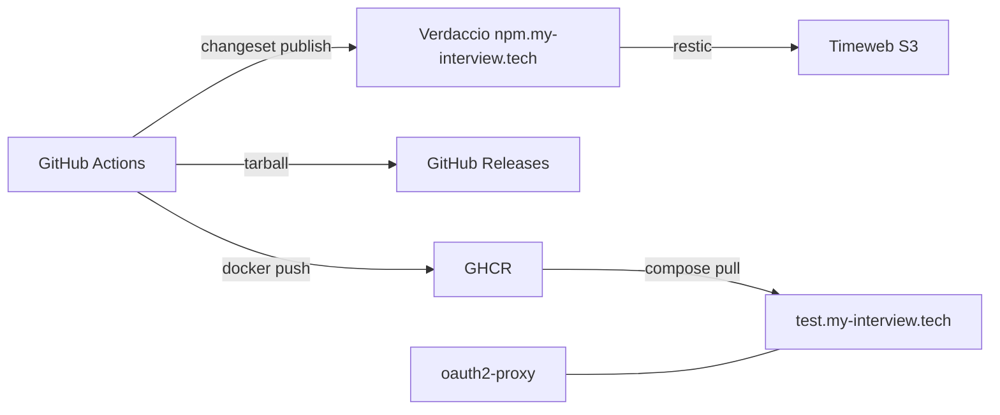

# infra

Конфиги сервисов на VPS: npm-реестр Verdaccio с бэкапом и закрытый test-стенд сайта. Процесс релиза и скрипты CI описаны в [scripts/README.md](../scripts/README.md).



Все сервисы слушают только `127.0.0.1`. Наружу их отдаёт Caddy хоста, сертификаты Let's Encrypt он выпускает сам. Прод `www.my-interview.tech` живёт в отдельном репозитории, его блок в `/etc/caddy/Caddyfile` отсюда не меняется.

Блоки из этого репозитория лежат в `/etc/caddy/sites/*.caddy`. Один раз руками на VPS:

```bash
mkdir -p /etc/caddy/sites
echo 'import sites/*.caddy' >> /etc/caddy/Caddyfile
caddy validate --config /etc/caddy/Caddyfile && systemctl reload caddy
```

## Verdaccio

Приватный реестр пакетов `@my-interview/*` на `npm.my-interview.tech`. Сайт в Docker ставит пакеты только отсюда.

| Файл                                 | Что это                                                                               |
| ------------------------------------ | ------------------------------------------------------------------------------------- |
| `verdaccio/docker-compose.yml`       | Verdaccio 6 на `127.0.0.1:4873`, том `verdaccio-storage`, healthcheck `/-/ping`       |
| `verdaccio/config.yaml`              | доступ только авторизованным, публикует `ci-publisher`, без uplink                    |
| `verdaccio/Caddyfile`                | блок `npm.my-interview.tech` в Caddy хоста, прокси на 4873                            |
| `verdaccio/create-htpasswd.sh`       | создаёт `htpasswd` с `ci-publisher` и `ci-reader` и печатает пароли                   |
| `verdaccio/backup.sh`                | разовый снапшот тома в restic                                                         |
| `verdaccio/backup-daily.sh`          | ежедневный снапшот и `forget --keep-daily 14 --prune`                                 |
| `verdaccio/verdaccio-backup.service` | oneshot-юнит для `backup-daily.sh`, окружение из `/root/.config/restic/verdaccio.env` |
| `verdaccio/verdaccio-backup.timer`   | запуск юнита каждый день в 03:40, пропуск догоняется после простоя                    |
| `verdaccio/create-bucket.sh`         | bucket в Timeweb S3: versioning, object lock                                          |

Uplink к npmjs нет: внешние зависимости ставятся из публичного npm, в Verdaccio — только наш scope (`.npmrc` в корне и в `apps/site`).

### Развернуть

1. Блок из `verdaccio/Caddyfile` в Caddy хоста. Сертификат Caddy выпустит сам, когда DNS `npm.my-interview.tech` укажет на VPS.
2. `create-htpasswd.sh` в каталоге `verdaccio/`. Скрипт печатает пароли: запускать в своём терминале, не в логе CI. `htpasswd` не коммитить.
3. `docker compose up -d` в `verdaccio/`.
4. Токены. Под `ci-publisher`: `npm login --registry https://npm.my-interview.tech` и `npm token create` — это `NPM_TOKEN_PUBLISH`. Так же под `ci-reader` — `NPM_TOKEN_READ`.

### Бэкап

Два независимых источника, чтобы потеря одного не теряла пакеты:

- **Снапшот тома.** `verdaccio-backup.timer` раз в сутки запускает `backup-daily.sh`: `restic backup` каталога `VERDACCIO_STORAGE` в Timeweb S3 и удаление снапшотов старше 14 дней. Если object lock не дал удалить объекты, свежий снапшот уже записан, скрипт только предупреждает. `backup.sh` — тот же снапшот разово, руками.
- **Tarball в GitHub Releases.** Их кладёт `scripts/attach-release-tarballs.sh` при каждой публикации.

На VPS окружение лежит в `/root/.config/restic/verdaccio.env`: `RESTIC_REPOSITORY`, `RESTIC_PASSWORD_FILE`, `VERDACCIO_STORAGE`, ключи S3. Пароль restic — в отдельном файле `/root/.config/restic/verdaccio.password`. Установить таймер:

```bash
install -m 700 backup-daily.sh /opt/my-interview/verdaccio/
install -m 644 verdaccio-backup.service verdaccio-backup.timer /etc/systemd/system/
systemctl daemon-reload && systemctl enable --now verdaccio-backup.timer
```

Bucket создаётся один раз админским ключом, endpoint `https://s3.twcstorage.ru`, регион `ru-1`:

```bash
BUCKET=<имя> infra/verdaccio/create-bucket.sh
```

- Versioning и object lock в режиме `GOVERNANCE` на 60 дней (`OBJECT_LOCK_DAYS`).
- Ключ VPS заводится в панели Timeweb без права `BypassGovernanceRetention`. Удалить снапшоты раньше срока он не может, поэтому взлом VPS не уничтожает бэкап.
- `restic init` выполняется админским ключом, не ключом VPS.

### Восстановить

`scripts/restore-registry.sh` переопубликует пакеты в порядке зависимостей и пропустит версии, которые уже есть в реестре:

```bash
scripts/restore-registry.sh --dry-run                    # план публикации
NPM_TOKEN=<publish-токен> scripts/restore-registry.sh    # из GitHub Releases, нужен GH_TOKEN
RESTORE_TARBALL_DIR=<папка с .tgz> scripts/restore-registry.sh
scripts/restore-registry.sh --from-restic                # сначала развернуть снапшот restic в RESTORE_DIR
```

## Test-стенд

Закрытая копия сайта на `test.my-interview.tech`. Выкладывает `scripts/deploy-site.sh` из `deploy-site.yml` после каждого push в `release`. На VPS всё лежит в `/opt/my-interview/test-stand`, отдельно от каталога прода.

| Файл                            | Что это                                                                                                                     |
| ------------------------------- | --------------------------------------------------------------------------------------------------------------------------- |
| `test-stand/docker-compose.yml` | `site-test` — образ `ghcr.io/my-interview-tech/site:${SITE_TAG}-test` на `127.0.0.1:8081`, oauth2-proxy на `127.0.0.1:4180` |
| `test-stand/oauth2-proxy.cfg`   | вход через GitHub: org `my-interview-tech`, team `test-access`, кука на `.test.my-interview.tech` на 168 часов              |
| `test-stand/Caddyfile`          | блок Caddy: `forward_auth` в oauth2-proxy, обход по заголовку `X-Test-Access`, `robots.txt` с `Disallow: /`, `X-Robots-Tag` |
| `test-stand/env.example`        | имена переменных `.env` на VPS, без значений                                                                                |

Доступ:

- **Люди** входят через GitHub. Нужно членство в команде `test-access` организации.
- **CI** проходит заголовком `X-Test-Access: <TEST_STAND_ACCESS_TOKEN>`. Токен лежит на хосте в `/etc/caddy/test-access.caddy` с правами 640 `root:caddy`: матчер `@needs_login`, который пускает в `forward_auth` всех без верного заголовка.

Что делает выкладка на VPS:

1. Копирует compose, `oauth2-proxy.cfg` и блок Caddy. `.env` и токен пишутся через stdin ssh, в аргументы команд не попадают.
2. `docker login ghcr.io`, `docker compose pull`, `docker compose up -d`.
3. Ставит блок в `/etc/caddy/sites/test.my-interview.tech.caddy` и токен в `/etc/caddy/test-access.caddy`. Если `caddy validate` или `systemctl reload caddy` не прошли, возвращает прежние файлы и падает. `/etc/caddy/Caddyfile` скрипт не пишет. Без строки `import sites/*.caddy` в нём выкладка падает с подсказкой.
4. Проверяет стенд снаружи: без заголовка он закрыт, с заголовком отвечает 200.

Предусловия на хосте:

- В `/etc/caddy/Caddyfile` есть `import sites/*.caddy`, см. начало файла.
- DNS `test.my-interview.tech` указывает на VPS. Сертификат Caddy выпускает при первом reload.
- OAuth App в организации с callback `https://test.my-interview.tech/oauth2/callback`.
- Ключ хоста записан в секрет `SSH_KNOWN_HOSTS`. Без него выкладка падает.
