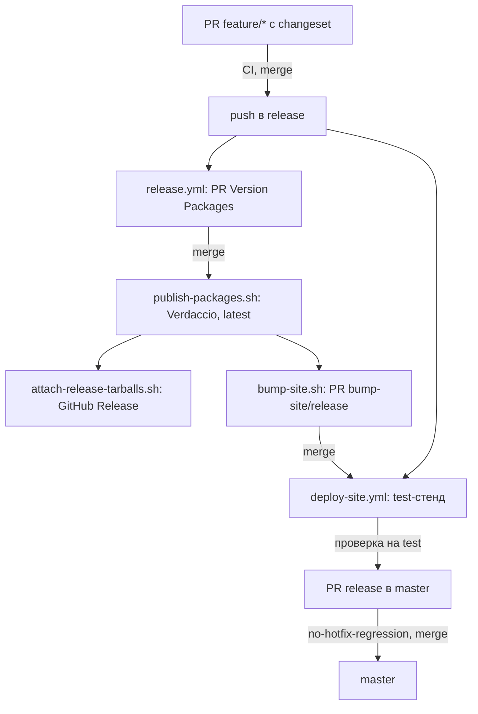
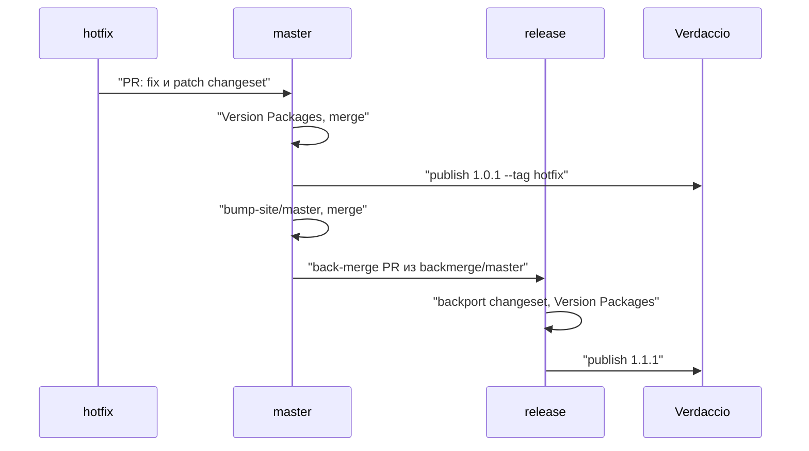

# scripts

Скрипты CI/CD монорепо: проверки, релиз пакетов, версии сайта, выкладка и восстановление реестра. Их вызывают workflow в `.github/workflows` и husky. Руками запускаются только отмеченные в таблице [скриптов](#скрипты).

Инфраструктура, на которую они опираются, — Verdaccio и test-стенд — описана в [infra/README.md](../infra/README.md).

## Ветки

| Ветка                 | Куда идёт                                   | Стенд                    |
| --------------------- | ------------------------------------------- | ------------------------ |
| `feature/*`, `CORE-*` | PR в `release`                              | —                        |
| `release`             | default branch                              | `test.my-interview.tech` |
| `master`              | PR из `release`                             | `my-interview.tech`      |
| `hotfix/*`            | PR в `master`, затем back-merge в `release` | —                        |

`branch-guard.yml` пускает в `master` только `release`, `hotfix/*`, `changeset-release/master` и `bump-site/master`. `master` попадает в `release` только через PR из `backmerge/master`.

## Обычный релиз

1. **PR в `release`.** Изменение в `packages/*/src` требует changeset: `yarn changeset`. CI (`ci.yml`) запускает:

   - `verify.sh`: lint, typecheck, test и build затронутых пакетов, `changeset status`;
   - `build-stand`: сборка сайта с переменными test и production;
   - `site-canary.sh`: сайт против текущих исходников пакетов;
   - `site-pinned`: Docker-образ сайта из реестра по закреплённым версиям;
   - `tsc` и `branch-guard`.

   Тот же `verify.sh` гоняет хук `pre-push`.

2. **Merge в `release`.** `release.yml` проверяет, что в `master` нет непринесённых коммитов в `packages/`, и открывает PR «Version Packages» из `changeset-release/release`. Параллельно `deploy-site.yml` выкладывает текущий сайт на test.
3. **Merge «Version Packages».** `publish-packages.sh` собирает пакеты и публикует новые версии в Verdaccio с dist-tag `latest`. Затем:
   - `attach-release-tarballs.sh` кладёт tarball каждого пакета в GitHub Release с тегом `@my-interview/<pkg>@x.y.z`;
   - job `bump-site` запускает `bump-site.sh`: точные версии в `apps/site/package.json`, новый `apps/site/yarn.lock`, PR из `bump-site/release`.
4. **Merge bump-PR.** Push в `release` выкладывает на test сайт уже с новыми версиями пакетов. До этого merge test показывает сайт на прежних версиях.
5. **PR `release` → `master`.** Дополнительно работает `no-hotfix-regression.sh`: новая версия пакета в сайте должна содержать хотфикс, который сейчас в `master`.
6. **Прод** этим конвейером не выкладывается. `deploy-site.sh` для `production` ничего не делает без `DEPLOY_PRODUCTION=true`, а с ней падает, чтобы не подменить текущий www.

## Хотфикс

Хотфикс только сайта, без `packages/`, — обычный PR `hotfix/*` → `master`, без публикации.

Если исправление в пакете, сначала выбрать путь. Когда версия пакета в `release` равна версии в `master` и в `release` нет неготовых изменений этого пакета, исправление идёт обычным релизом через `release`. Ветка от `master` нужна, только когда `release` по этому пакету ушёл вперёд.

1. `hotfix/*` от `master`: исправление и patch changeset. Проверить на test до merge можно ручным запуском `deploy-site.yml` из `release` с `ref=hotfix/...`. Следующий push в `release` вернёт test обратно.
2. Merge, «Version Packages» в `master`, публикация с dist-tag `hotfix`. `latest` остаётся за версией из `release`, иначе он откатился бы с `1.1.0` на `1.0.1`. Сайт закреплён точными версиями, на него dist-tag не влияет.
3. `bump-site` открывает PR из `bump-site/master` с новой версией в сайте.
4. Push в `master` запускает `back-merge.yml`. Workflow создаёт `backmerge/master` от `release`, мержит `master` и вызывает `backmerge.sh`:
   - конфликт `version` в `package.json` пакета — берётся старшая версия;
   - `CHANGELOG.md` — секции обеих веток без дублей;
   - `apps/site/package.json` и `yarn.lock` — как в `release`, lock пересобирается;
   - если в `release` версия пакета выше, чем в `master`, добавляется patch changeset `backport: ...`. Changeset хотфикса уже израсходован в `master`, без нового исправление не попадёт в линию `1.1.x`.
5. Back-merge PR вливается merge commit, не squash.

Защита от потери хотфикса:

- `release.yml` на `release` падает до публикации, пока в `master` есть коммиты в `packages/`, которых нет в `release`. Иначе `release` выпустил бы свою `1.0.1` с другим кодом, а `changeset publish` молча пропустил бы существующую версию.
- `no-hotfix-regression.sh` на PR в `master` сравнивает теги, а не semver: `1.1.0` больше `1.0.1`, но хотфикса в ней нет. Пройдёт только версия, чей тег — потомок тега хотфикса.
- `concurrency: release-publish` без отмены: две публикации не идут одновременно.

## Выкладка сайта

`deploy-site.yml` разделён на два job:

- **build** собирает `inputs.ref` или текущий коммит в отдельном каталоге без SSH-секретов. Образ — `ghcr.io/my-interview-tech/site:<sha>-test`. Без `apps/site/yarn.lock` сборка пропускается с кодом 0.
- **deploy** берёт `deploy-site.sh` и `infra/test-stand` только из коммита workflow. Без `SSH_HOST` или `SSH_KEY` выкладка пропускается с кодом 0. Остальные секреты обязательны.

Ручной запуск:

| Вход                     | Что делает                                           |
| ------------------------ | ---------------------------------------------------- |
| `environment=test`       | новая сборка и выкладка на test                      |
| `sha=<sha>`              | откат на уже собранный образ, без сборки             |
| `ref=hotfix/...`         | сборка указанной ветки, запуск только из `release`   |
| `environment=production` | ничего не делает, пока `DEPLOY_PRODUCTION` не `true` |

После выкладки скрипт проверяет стенд: без заголовка `X-Test-Access` он не должен отдавать 200, с заголовком — должен.

## Скрипты

| Скрипт                       | Кто вызывает                           | Что делает                                                   |
| ---------------------------- | -------------------------------------- | ------------------------------------------------------------ |
| `verify.sh`                  | `pre-push`, `ci.yml`                   | проверки затронутых пакетов, changeset, сборка стенда        |
| `site-canary.sh`             | `ci.yml`                               | сайт против текущих исходников пакетов                       |
| `no-hotfix-regression.sh`    | `ci.yml`, PR в `master`                | новая версия пакета содержит хотфикс из `master`             |
| `publish-packages.sh`        | `release.yml`                          | сборка и публикация пакетов, из `master` с dist-tag `hotfix` |
| `attach-release-tarballs.sh` | `release.yml`, руками                  | tarball в GitHub Release — резервная копия реестра           |
| `bump-site.sh`               | `release.yml`                          | точные версии пакетов в сайте и PR из `bump-site/<ветка>`    |
| `lock-site.sh`               | `bump-site.sh`, `backmerge.sh`, руками | `apps/site/yarn.lock` только из реестра, для Docker          |
| `backmerge.sh`               | `back-merge.yml`                       | конфликты мержа `master` → `release` и backport changeset    |
| `deploy-site.sh`             | `deploy-site.yml`                      | сборка образа и выкладка на test-стенд                       |
| `restore-registry.sh`        | руками                                 | переопубликовать Verdaccio из tarball по графу зависимостей  |
| `bundle-size.mjs`            | руками                                 | размер бандла сайта, сравнение до и после                    |

У каждого скрипта в шапке написано, что он делает, зачем и какие переменные ждёт.

## Секреты и переменные

| Имя                                                                                  | Тип      | Где нужно                                                        |
| ------------------------------------------------------------------------------------ | -------- | ---------------------------------------------------------------- |
| `NPM_TOKEN_READ`                                                                     | secret   | установка из Verdaccio в CI, Docker и bump                       |
| `NPM_TOKEN_PUBLISH`                                                                  | secret   | `changeset publish`                                              |
| `BOT_TOKEN`                                                                          | secret   | PR и push от бота, иначе `github.token`                          |
| `SSH_HOST`, `SSH_USER`, `SSH_KEY`, `SSH_KNOWN_HOSTS`                                 | secret   | выкладка на VPS                                                  |
| `TEST_STAND_ACCESS_TOKEN`                                                            | secret   | заголовок `X-Test-Access` для CI, от 32 символов `[A-Za-z0-9_-]` |
| `OAUTH2_PROXY_CLIENT_ID`, `OAUTH2_PROXY_CLIENT_SECRET`, `OAUTH2_PROXY_COOKIE_SECRET` | secret   | вход на test через GitHub                                        |
| `GHCR_READ_TOKEN`                                                                    | secret   | `docker pull` образа на VPS                                      |
| `GHCR_USER`                                                                          | variable | логин для GHCR на VPS                                            |
| `TEST_VITE_*`, `PROD_VITE_*`                                                         | variable | `VITE_*` для сборки test и production                            |
| `DEPLOY_PRODUCTION`                                                                  | variable | разрешение выкладки production, сейчас не задано                 |

Окружение `test` пускает только ветку `release`, `production` — только `master`.

## Локально

- Yarn 1 падает, если переменной `NPM_TOKEN` нет совсем. Пустое значение допустимо: `export NPM_TOKEN="${NPM_TOKEN:-}"`.
- `pre-push` сравнивает с `origin/release`. Если такой ветки нет, `verify.sh` попросит `git fetch origin release`.
- `site-canary.sh` переписывает `apps/site/package.json`. После локального запуска файл нужно откатить.
- Проверка без побочных эффектов: `attach-release-tarballs.sh --dry-run name@version`, `restore-registry.sh --dry-run`.
- Первый `apps/site/yarn.lock` появляется после первой публикации: `bump-site.sh` видит и неотслеживаемый lock и кладёт его в bump-PR. Руками тот же lock собирает `NPM_TOKEN=<read-токен> scripts/lock-site.sh`.
